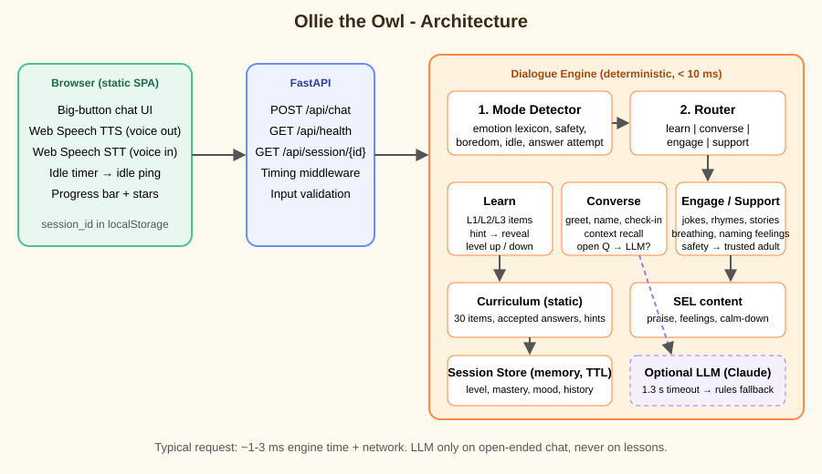
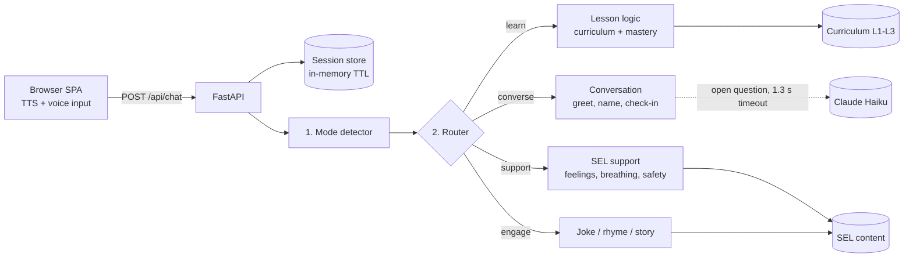

# System Design - Ollie the Owl

## 1. Goals and constraints

| Goal | Consequence for design |
|---|---|
| Teach English to children under 7, in 3 levels | Small, hand-authored curriculum with mastery tracking |
| Not "always teaching" | Explicit mode layer in front of the lesson logic |
| SEL for ages 3-6 | Dedicated SEL content + support mode that outranks lessons |
| Context-aware | Per-session profile (level, mastery, mood, last word, history) |
| End-to-end < 2 s | Deterministic core; LLM optional and time-boxed |
| Child safety | Safety phrases short-circuit everything; LLM output filtered; no PII requested |
| Live URL by deadline | One container, no database, deployable on a free tier |

## 2. Architecture

### Request flow

1. Browser sends `{session_id, message, idle}`. The idle flag is sent by a 45 s client timer when the child goes quiet.
2. `engine.handle` loads the session, converts emoji to words (children tap 😀/😢), and calls `modes.detect`.
3. Detector precedence (first match wins): **safety → negative emotion → low confidence → idle → asked for fun → disengaged / repeated failure → low energy → open exercise (attempt) → wants to learn → chat**.
4. The router runs one of four turn handlers, updates the session, and returns reply + emoji + quick-reply buttons + progress.

## 3. Components

### 3.1 Progressive learning (`curriculum.py`, `engine.py`)

- **L1 Words** (cat, dog, apple, colours, one/two…): repeat or choose between two pictures/words.
- **L2 Phrases** ("I see a ___", counting to 5, "What does a cow say?", hello/thank you).
- **L3 Sentences** (verbs, opposites, in/on, "My name is…", word order, feelings sentence).
- Each item has accepted answers, an escalating **hint → reveal** path, and emoji for visual support (pre-readers).
- **Mastery** per item (0-1): +0.34 first-try correct, +0.2 correct after hint, -0.25 on a miss.
- **Level up:** ≥ 6 correct at the level and ≥ 75% over the last 8 attempts. **Level down:** < 35% over ≥ 6 attempts. A gentle message is shown either way.
- **Item selection:** unseen items first; every 4th item is a **spaced review** of the weakest word seen so far; after the level is exhausted, lowest mastery first.
- **Answer checking:** normalised tokens, digits ↔ number words for counting, negation guard ("not cat"), and typo tolerance (similarity ≥ 0.8) for words of 4+ letters, because 5-year-olds can't spell yet.

### 3.2 Child mode detection (`modes.py`)

| Mode | Triggered by | Bot behaviour |
|---|---|---|
| `support` | sad/angry/scared/shy words, "I can't", safety phrases | Name the feeling, validate, offer *breath / talk / game*; never continues the lesson in this turn |
| `engage` | bored, "idk", "no", idle timer, joke/song/story requests, 3 wrong in a row | Joke, original rhyme or short story, then a soft invitation back |
| `converse` | greetings, names, thanks, bye, questions, tired/hungry, happy sharing | Warm reply, context recall, optional LLM for open questions |
| `learn` | open exercise (any attempt), "yes / play / more / next" | Present item, judge answer, praise or hint |

Why rules instead of an ML classifier: sub-millisecond, explainable (each decision stores a `reason`), testable with unit tests, and no training data needed for a 2-day build. The cost is lower recall on unusual phrasing; the precedence order is deliberately conservative so a wellbeing signal is never overridden by a lesson.

### 3.3 Social-Emotional Learning (`sel.py`)

| SEL competency | Implementation |
|---|---|
| Self-awareness | Child's feeling is named back ("You feel sad. That is okay."). Periodic emoji check-in (😀 😐 😢). |
| Self-management | "Smell the flower, blow the candle" breathing; offer of rest. No pain- or shock-based techniques. |
| Confidence / growth mindset | Praise effort ("You tried hard"), "I can't… YET", mistakes framed as brain-growing |
| Curiosity | "I wonder…" prompts; every question is welcomed |
| Social skills | hello, thank you, kindness stories; name use |
| Safety | Phrases like "someone hurts me" return a trusted-adult message and `safety_flag: true` for adult-side alerting |

### 3.4 Context awareness (`state.py`)

Session fields drive behaviour: `level`, `mastery{}`, `recent_results`, `mood`, `mood_history`, `last_word`, `name`, `lesson_streak`, `wrong_streak`, `history` (last 8 turns). Examples: greeting recalls "Last time you felt a little down" or "Do you remember the word *cat*?"; the lesson check-in fires after 3 consecutive learn turns; wrong streaks trigger an engagement break rather than more failure.

### 3.5 Optional LLM (`llm.py`)

Used only in `converse` for free-form questions. System prompt fixes persona, vocabulary level, ≤ 25 words, no personal-data questions, no scary topics. Output is rejected if it is long, contains links, or contains blocked words. Timeout 1.3 s → silent fallback to rule-based text.

## 4. Latency budget (< 2 s)

| Step | Budget | Measured |
|---|---|---|
| Network (client ↔ server) | ~100-300 ms | depends on region |
| FastAPI + validation | < 5 ms | ~1 ms |
| Mode detection + turn logic | < 10 ms | ~0.4 ms |
| LLM (only on open chat) | ≤ 1.3 s hard cap | n/a on lesson turns |

Local measurement (60 requests, mixed modes): **p50 1 ms, p95 2 ms, max 3 ms**. `scripts/latency_check.py` re-runs this against the deployed URL. The only meaningful risk is a **free-tier cold start** (see README).

## 5. Key decisions and trade-offs

| Decision | Alternative | Why / trade-off |
|---|---|---|
| Rule-based core, optional LLM | LLM for everything | Guaranteed < 2 s, predictable and child-safe, free to run. Less flexible than an LLM for open talk, mitigated by the optional LLM path |
| In-memory sessions | Redis / SQLite | Zero setup and zero latency. Lost on restart and limited to one instance. Session is a dataclass, so a Redis/SQLite store is a small swap |
| Hand-authored curriculum (30 items) | Generated content | Pedagogically controlled and safe. Smaller content volume; adding items is data-only |
| FastAPI + vanilla JS SPA | React / native app | One container, no build step, fast load on cheap tablets |
| Browser TTS/STT | Cloud speech APIs | Free and instant. Quality varies by browser; kids' ASR is imperfect, so typed/tap answers always work |
| Lexicon emotion detection | Fine-tuned classifier | Explainable and instant. Lower recall; conservative precedence compensates |
| Buttons for answers (quick replies) | Typing only | Pre-readers and non-typers can still play |

## 6. Safety and privacy

- Only an optional first name is stored, in memory, with a 6 h TTL. No accounts, no logs of message bodies beyond the last 8 turns per live session.
- LLM prompt forbids requesting personal information; output filtered.
- Safety phrases bypass lessons and the LLM; `safety_flag` is surfaced so a guardian-facing layer can alert adults (not implemented, see below).
- Not yet COPPA/GDPR-K compliant. A production version needs parental consent and a data-retention policy.

## 7. Scaling path

1. Replace `SessionStore` with Redis (JSON of `Session.to_dict()`), allowing multiple workers/instances.
2. Persist progress per child account for parent dashboards, and wire `safety_flag` to guardian notifications.
3. Replace lexicon emotion detection with a small distilled classifier, keeping the lexicon as a safety net.
4. Add pronunciation scoring and more curriculum content (phonics, simple stories), possibly LLM-generated but human-reviewed.
5. Add rate limiting and basic abuse protection at the edge.

## 8. Testing

`pytest` runs 44 tests: mode-detection table tests, answer-matching edge cases (typos, numbers, negation, word order), flow tests (hint → reveal, level up/down, SEL check-in, bored → engage → back to learn, sad → support → breathing, safety flag, context-aware greetings), input robustness (empty, 5000 chars, emoji), curriculum integrity, and an API round-trip asserting each response under 2 s.
